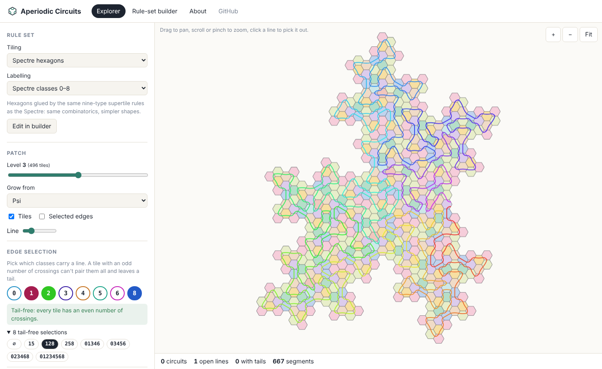
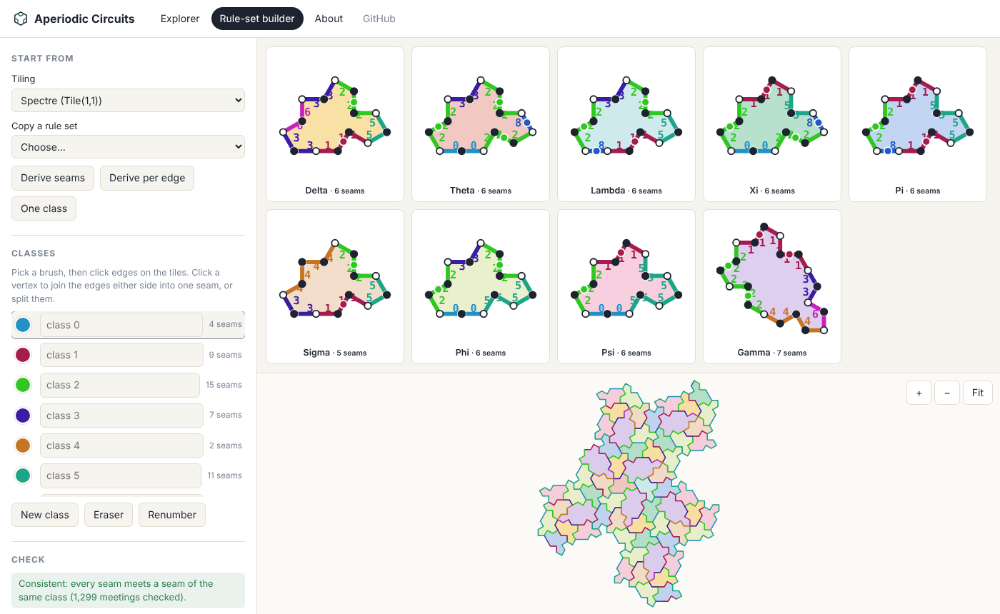
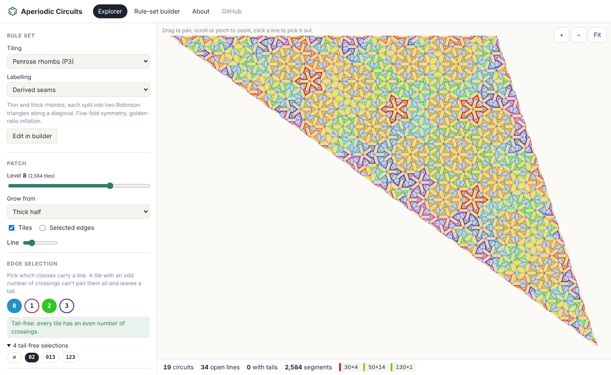

# Aperiodic Circuits

## [Live site: bohemian-miser.github.io/aperiodic-circuits](https://bohemian-miser.github.io/aperiodic-circuits/)

<a href="https://bohemian-miser.github.io/aperiodic-circuits/#/explore?t=hex&lv=3&root=Psi&s=128-010100000"></a>

<sub>Rule <code>128-010100000</code> on the Spectre hexagons: one line through every tile of the supertile, the infinite line from the <a href="https://github.com/bohemian-miser/Spectre/blob/main/docs/FASS_THEOREM.md">Spectre project</a>.</sub>

The [Spectre circuits](https://github.com/bohemian-miser/Spectre) idea, opened up: pick an aperiodic tiling, **make your own rule set** for which edges carry lines and which edges count as the same class, then explore what the selections and combinations do. You get closed circuits, lines that run off forever, or tails.

## Pages

* **Explorer** (`#/explore`): grow a patch of any tiling, pick the classes that carry a line, and pick a pairing per tile. Circuits are coloured by length, open lines run red to violet along their length, and tails are red. Click a line to pick it out. The **survey** runs every combination of the current selection on a smaller patch and tabulates circuits, distinct lengths, longest circuit and open lines.
* **Rule-set builder** (`#/build`): paint classes onto prototile edges, join or split seams, rename classes, and see straight away whether the labelling is consistent and how many edge selections are tail-free. Save rule sets in the browser, export or import them as JSON, or open them in the explorer with a link that carries the whole rule set.
* **About** (`#/about`): the definitions and the tiling JSON format.

<table>
<tr>
<td width="50%"><br>Builder, Spectre labels</td>
<td width="50%"><br>Penrose rhombs, derived classes, selection <code>02</code></td>
</tr>
</table>

## How it fits together

| Term | Meaning |
| --- | --- |
| **Tiling** | Prototiles plus a substitution that grows a patch. Built in: the Spectre hexagons, the Spectre (Tile(1,1), with the Mystic as one tile), Penrose rhombs (as Robinson triangles), and the chair. Paste your own as JSON in the builder. |
| **Seam** | A run of consecutive edges of a prototile that always meets one neighbour as a whole. One line crosses an active seam, at its arclength centre, so both tiles agree on the point. |
| **Rule set** | Which edges form seams and which class each seam is in. It's *consistent* when every seam only ever meets seams of its own class. |
| **Edge selection** | The classes that carry a line, e.g. `128`. |
| **Combination** | One digit per prototile picking a non-crossing pairing of its crossings (Catalan(k) choices for 2k crossings). The share string is `selection-digits`, e.g. `128-010100000`. For the two nine-type tilings the digits are in the Spectre project's order, so its share strings mean the same thing here. |

**Deriving rule sets.** Every tiling ships with a labelling worked out from its own adjacency: seams are the runs of edges a tile shares with one neighbour, and two seams share a class exactly when they meet somewhere in the patch (union-find). That's the finest consistent labelling. Merging any of its classes stays consistent, and the builder's *Merge classes that meet* repairs a broken labelling the same way. On the Spectre this gives 12 classes rather than the Spectre project's 8, which makes it a new rule set to explore.

**Refining.** A one-tile tiling like the chair only has one derived class. *Refine tiles by supertile slot* splits each prototile by which slot of its parent it fills. That's how the Spectre gets nine types, and it gives the chair four types and ten classes.

**The tails problem.** Only parity matters, so the tail-free selections are the null space of the types × classes incidence matrix over GF(2). With the Spectre project's labels on the hexagons that gives the eight known selections `∅ 15 128 258 01346 03456 023468 01234568`. The tests check this, and also check that rule 15 only makes circuits of length 3, 6 and 9, and that `128-010100000` threads a single arc through every tile of a Psi supertile.

## Code

```
src/core/          the engine, no React
  tiling.ts        prototiles, similarity substitutions (JSON), refinement
  tilings/         the built-in tilings (spectre.ts ports the Spectre project's supertile construction)
  ruleset.ts       seams, adjacency, deriving classes, validation, editing
  matchings.ts     non-crossing pairings
  parity.ts        tail-free selections over GF(2)
  circuits.ts      chords, tracing circuits / open lines / tails
  share.ts         share strings
src/components/    canvas patch renderer, SVG tile glyphs
src/pages/         Explorer, Builder, About
src/store.ts       built-in and saved rule sets, bundles, share links
```

## Running it

```bash
npm install
npm run dev      # http://localhost:8082/aperiodic-circuits/
npm test
npm run build && npm run preview
```

Pushing to `main` builds and deploys the site with `.github/workflows/pages.yml`. In the repo's **Settings → Pages**, set **Source** to **GitHub Actions** (one-off).

## Ideas for next

* An infinite map that grows around the camera, as in the Spectre project.
* More tilings: Ammann–Beenker, hats and turtles, the pinwheel (not edge-to-edge, so it would need split edges).
* Seam orientation (`k` meets `-k`), so a rule set can say which way round classes glue.
* A classification scatter over every combination of every rule, like the Spectre project's.
